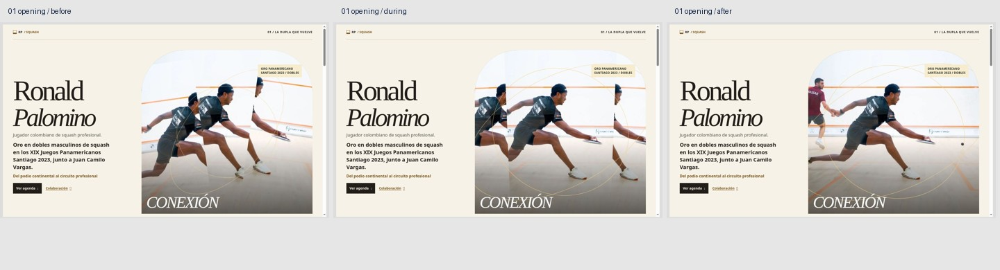
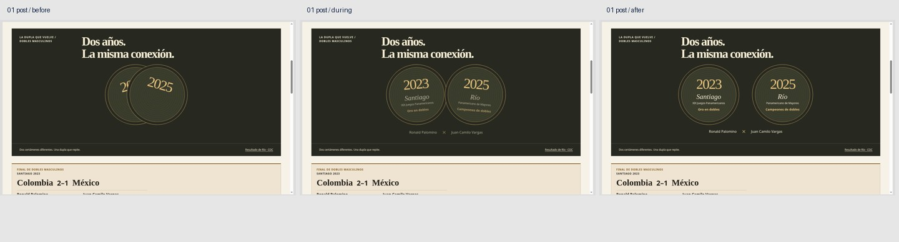
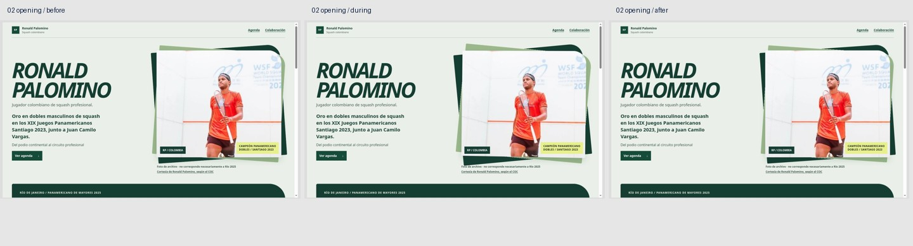
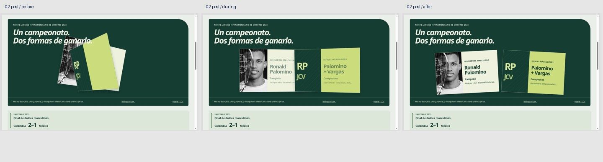
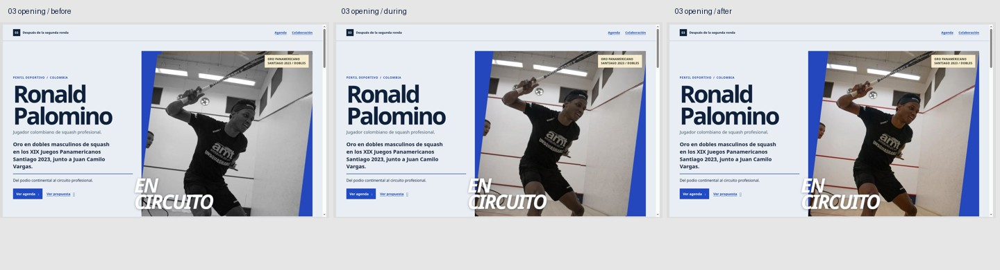
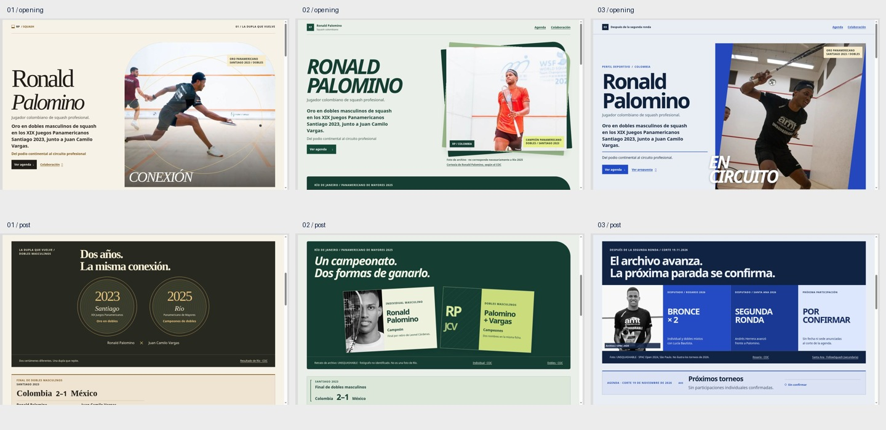

# Ronald Palomino — Referencias y QA

Fecha de inspección y comprobación: **19 de noviembre de 2026**. Trabajo realizado sobre el ZIP recibido, servido desde su carpeta descomprimida. La portada no se rediseñó. El alcance de los cambios es la presentación dentro de 01, 02 y 03, más el código compartido nuevo y esta evidencia.

## Actualización del núcleo del hero

En 01, 02 y 03 se añadió antes del nombre un bloque visible desde el primer render: **Campeón panamericano / Rumbo a Los Ángeles 2028 / El sueño olímpico**. El título es una credencial; la participación olímpica se presenta como objetivo y no como clasificación confirmada. El bloque adopta el oro editorial de 01, la placa verde de 02 y el acento cobalto de 03. No se vincula a las animaciones ni se oculta mientras cargan.

Las capturas de las secciones originales documentan la versión previa a este ajuste de texto. Las nuevas capturas `core-01/02/03-desktop.jpg` y `core-01/02/03-mobile.jpg` documentan los heroes actualizados. La portada, el selector, las agendas, las fotografías y los gestos de motion permanecen sin cambios.

## Criterio de observación

**Captura** significa composición vista realmente en navegador, sin atribuirle una animación. **Movimiento observado** distingue video o cambio durante el scroll de la motion que se creó para Ronald. No se considera una imagen fija como prueba de una transición. Las nueve referencias son portafolios públicos de deportistas; se eligieron por recursos visuales. Las capturas de otros atletas están únicamente en documentación y nunca se cargan en las páginas de Ronald.

La decisión previa a modificar los HTML está en [DECISION_VISUAL.md](DECISION_VISUAL.md).

## 01 · La dupla que vuelve — tres referencias

| Sitio y URL | Sección exacta y captura | Qué se nota a primera vista | Observado / selección |
| --- | --- | --- | --- |
| [Katja Wolfinger](https://katjawolfinger.com/) | Hero de inicio “Wachse mit mir.” [Captura](evidencia/referencias/03-katja.jpg) | Geometría de pista entrelazada, simétrica y a gran escala sobre acción; no parece un adorno independiente de la foto. | Composición observada y fondo audiovisual. No se verificó una animación específica de las curvas. **Seleccionada:** geometría que abraza dos focos y encuadra la acción. |
| [Cody Townsend](https://www.codytownsend.com/) | Inicio: “This sport has given me everything” y arranque de “Buenos Dias!” [Captura](evidencia/referencias/02-cody.jpg) | Cambio brusco entre manifiesto tipográfico de gran escala y fotografía ancha con letras sobre ella. | **Captura**; no se atribuye al sitio una apertura animada. **Seleccionada:** salto de escala editorial, foto protagonista y palabra sobre el margen inferior de la imagen. |
| [Lando Norris](https://landonorris.com/) | “Message from Lando”, marca superior; archivo con “High Performance Gala, 2024”, “Battersea, 2024” y “Barcelona, 2024”. [Gesto gráfico](evidencia/referencias/01-lando.jpg) / [Archivo](evidencia/referencias/01-lando-archive.jpg) | Contraste serif/sans en la marca; firma enorme aislada; tamaños y alturas muy distintos en el archivo fotográfico. | Se observó el cambio de composición al avanzar por scroll. No se afirma haber validado su máscara WebGL o su seguimiento del cursor. **Seleccionada:** contraste tipográfico y jerarquía de escala; no se reproduce la firma del atleta. |

**Lo reproducido.** En la apertura, dos ventanas de la foto original de acción se desplazan y despejan el encuadre; dos elipses se registran como una misma secuencia. El nombre y la credencial permanecen quietos y visibles. El encuadre curvo, la palabra “Conexión” y el contraste entre serif regular e itálica trasladan la composición editorial a Ronald.

**Post-hero.** Dos medallones inicialmente superpuestos se separan y descubren dos certámenes distintos: Santiago 2023 y Río 2025, unidos por Palomino–Vargas. Es una transformación de la relación entre hitos; no es otra foto con un fade. La textura concéntrica y la disposición entrelazada adaptan la geometría observada en Katja. La separación y el ritmo de revelado son código y motion propios, no una animación atribuida al sitio de Katja.

## 02 · Dos títulos, dos fichas — tres referencias

| Sitio y URL | Sección exacta y captura | Qué se nota a primera vista | Observado / selección |
| --- | --- | --- | --- |
| [Alex Albon](https://www.alexalbon.com/) | Hero con nombre en el extremo inferior derecho y primera fila de noticias / próxima carrera. [Captura](evidencia/referencias/08-alex.jpg) | Una placa fotográfica dominante, esquina inferior redondeada y tarjetas con jerarquía muy clara inmediatamente después. | **Captura**; se vio el contador, pero no se toma como referencia de una apertura. **Seleccionada:** placa editorial y esquinas de radio desigual; no se replica el contador ni el componente comercial. |
| [Charles Leclerc](https://charlesleclerc.com/en/) | “The Driver”, sección inicial “Beyond Speed”. [Captura](evidencia/referencias/07-charles.jpg) | Letras de póster delante de una escena a pantalla completa, con un marco de retícula y niveles visuales separados. | **Movimiento observado:** el video de fondo cambió entre capturas. No se afirma que el título tenga un efecto particular no comprobado. **Seleccionada:** escala de póster y fotografía con placas en profundidad; se adapta a una imagen fija real de Ronald. |
| [Kilian Jornet](https://www.kilianjornet.cat/) | Inicio: nombre y marca sobre paisaje de acción, antes de “Who is Kilian”. [Captura](evidencia/referencias/09-kilian.jpg) | Identidad compacta sobre una fotografía dominante, sin recuadros de ficha curricular en el hero. | **Captura**; no se usa la presencia de un reproductor como prueba de reproducción automática. **Seleccionada:** integrar una credencial breve al plano fotográfico y dar una jerarquía editorial clara al hito. |

**Lo reproducido.** Foto de archivo en una placa editorial, respaldos desfasados, esquina asimétrica, tipografía itálica de póster y credencial integrada. Al cargar, la fotografía corrige su perspectiva mientras los dos respaldos convergen detrás; es un único despliegue coordinado, no un título que entra deslizando. La pose y el rostro de Ronald siempre están presentes en la imagen base.

**Post-hero.** Un par de tarjetas inicialmente apiladas abre sus planos en perspectiva y revela las dos modalidades ganadas en Río 2025: individual y dobles. La primera usa el retrato editorial de Ronald; la segunda emplea RP / JCV, sin inventar una foto de la dupla. Se conserva la nota de retiro de Leonel Cárdenas. La mecánica de reparto de fichas es una adaptación original de la jerarquía de placas, no una afirmación sobre la motion de Albon.

## 03 · Después de la segunda ronda — tres referencias

| Sitio y URL | Sección exacta y captura | Qué se nota a primera vista | Observado / selección |
| --- | --- | --- | --- |
| [Mathieu Crépel](https://www.mathieu-crepel.com/) | Inicio “Born in the Mountain”, ventana vertical de snowboard delante de paisaje. [Inicio](evidencia/referencias/04-mathieu.jpg) / [Después de scroll](evidencia/referencias/04-mathieu-scroll.jpg) | Un recorte vertical próximo a cámara convive con un paisaje enorme: dos escalas y dos profundidades en una sola composición. | **Movimiento observado:** video y cambio de escena al avanzar por scroll. No se afirma que se haya medido su interpolación exacta. **Seleccionada:** máscara estrecha / campo amplio / registro de planos. |
| [Hunter Yeany](https://www.hunteryeany.com/) | Hero “Ambition Is Forever”. [Captura](evidencia/referencias/05-hunter.jpg) | Acción y trofeo con encuadre muy cercano, campo oscuro y bloque tipográfico compacto en una esquina. | Composición observada; solo se utiliza como **captura** para la selección. No se da por probado un efecto de entrada. **Seleccionada:** encuadre activo, contraste y bloque tipográfico localizado. |
| [Lewis Hamilton](https://www.lewishamilton.com/) | Pantalla inicial con retrato, edificio de ventanas rojas y coche. [Captura](evidencia/referencias/06-lewis.jpg) | El nombre ocupa una zona propia del encuadre y el retrato domina sin tarjetas superpuestas sobre la cara. | **Captura**; no se observó una transición concreta. **Seleccionada:** separar identidad y foco del retrato; dejar respirar el sujeto. |

**Lo reproducido.** Campo cobalto y foto original del Club Campestre recortada en diagonal. Tres bandas de archivo se registran en profundidad hasta formar un único encuadre. El nombre queda fuera del plano fotográfico y el rótulo “En circuito” se localiza en el borde, siguiendo la separación de escalas y planos de las referencias. El movimiento diagonal concreto es propio.

**Post-hero.** Una tira de archivo se despliega y cambia de lectura: el retrato con trofeo SPAC 2024 queda como archivo, mientras aparecen tres estados documentales — dos bronces en Rosario; segunda ronda de Santa Ana; próxima participación sin confirmar. La imagen no se atribuye a ninguno de los torneos de 2026. Se revela información nueva, no se reutiliza el recorte del hero.

## Candidata descartada

[Justin Jefferson](https://jjettas.com/) devolvió una pantalla “The experience couldn’t load.” Tras un único reintento no se obtuvo una experiencia visual verificable. [Captura del fallo](evidencia/referencias/07-justin.jpg). Se sustituyó por Charles Leclerc. No se usó su motion ni se cuenta entre las nueve referencias seleccionadas.

## Fotografías y contexto

No se descargó ninguna fotografía de los sitios de referencia para el producto. Se conservan las cinco fotos locales del ZIP y el archivo original [CREDITOS_FOTOGRAFICOS.md](CREDITOS_FOTOGRAFICOS.md).

| Uso nuevo | Archivo local | Contexto y crédito visibles |
| --- | --- | --- |
| 01, ventanas del opening | `ronald-accion-cancha.webp` | Acción de archivo; suministrada por Ronald Palomino, según El País. Se conserva el pie original. |
| 02, ficha individual del post | `ronald-retrato-raqueta.webp` | Retrato editorial publicado por UNSQUASHABLE; fotógrafo no identificado. Se indica expresamente que no es una foto de Río. [Fuente fotográfica](https://unsquashable.com/blogs/world-tour-highlights/ronald-palomino-crowned-pan-american-squash-champion) |
| 03, bandas del opening | `ronald-campestre-cali.webp` | Archivo vinculado al Club Campestre de Cali; Club Campestre / El País, según el pie. Se conserva el crédito original. |
| 03, tira de archivo del post | `ronald-trofeo-spac.webp` | Publicado por UNSQUASHABLE; SPAC Open 2024, São Paulo. No ilustra Rosario o Santa Ana. [Fuente fotográfica](https://unsquashable.com/blogs/world-tour-highlights/ronald-palomino-wins-psa-spac-squash-open-in-sao-paulo-brazil) |

## Cómo se obtuvieron los fotogramas

Los archivos `*-before.jpg`, `*-during.jpg` y `*-after.jpg` son capturas del navegador de las páginas reales. El [visor de QA](evidencia/qa/visor.html) carga cada HTML y pausa sus animaciones CSS en **0, 650 y 2150 ms**; el watchdog de finalización se omite solamente desde ese visor para permitir la captura pausada. La página de producción no incluye ese visor ni sus controles. Los montajes `*-secuencia.jpg` reúnen esas mismas capturas con etiquetas, sin sintetizar estados.

Se usó además **Carga natural** y scroll nativo para comprobar el comportamiento sin pausa. Los seis montajes son evidencia de estados de la animación real, no un video grabado ni una medición de rendimiento.

## QA realizado y límites

La tabla conserva el QA visual de la entrega original. La revisión de repetición solo cambia el ciclo de activación en `welcome.js`, `opening-bridge.js` y `assets/firma.js`; no modifica el HTML de las demos, su CSS, las fotos, el MP4 ni el póster.

| Comprobación | Resultado / evidencia |
| --- | --- |
| Portada, selector, CSS de bienvenida, JS de bienvenida, puente, MP4 y póster | **PASS.** Comparación byte a byte con el ZIP recibido. No se modificaron. |
| Nombre, credencial y agenda de las tres opciones | **PASS.** Fragmentos HTML exactos conservados. JSON y herramientas de agenda intactos. |
| Fotos y enlaces originales | **PASS.** Fotos originales idénticas; todos los href originales permanecen. Rutas locales resueltas; sin IDs duplicados. [Comprobación estática](evidencia/qa/comprobacion-estatica.json) |
| Escritorio | **PASS visual en Chrome.** Aperturas, tres post-hero y créditos inspeccionados. Ancho de navegador aproximado 1360 px; iframe de QA de escritorio con ancho disponible y altura 800 px. [Vista conjunta](evidencia/qa/vista-tres-opciones.jpg) |
| Móvil 390 × 844 | **PASS visual de layout responsive en iframe Chrome**, con scrollbar de escritorio; no es un dispositivo físico. Se revisaron las tres aperturas y los tres post-hero. [01 apertura](evidencia/qa/01-mobile-opening.jpg), [01 post](evidencia/qa/01-mobile-post.jpg), [02 apertura](evidencia/qa/02-mobile-opening.jpg), [02 post](evidencia/qa/02-mobile-post.jpg), [03 apertura](evidencia/qa/03-mobile-opening.jpg), [03 post](evidencia/qa/03-mobile-post.jpg). |
| Ancho 320 px | **PASS visual de layout.** Se corrigieron el tamaño de Palomino en 02, sus fichas y el rótulo “Por confirmar” en 03. En 01 los medallones se apilan. [01](evidencia/qa/01-small-post.jpg), [02](evidencia/qa/02-small-post.jpg), [03](evidencia/qa/03-small-post.jpg). |
| Carga directa de 01, 02 y 03 | **PASS visual por HTTP local**, desde la carpeta descomprimida. Foto, nombre y credencial visibles. [02 directa](evidencia/qa/02-directa.jpg), [03 directa](evidencia/qa/03-directa.jpg). |
| Coordinación con bienvenida | **PASS en recorrido real del selector.** Los animationstart registrados indican `bienvenida visible=false` y `opción activa=true`. Los documentos terminan en `sf-done`. El recuento es de eventos por capa CSS, no de openings completos. [Registro final escritorio](evidencia/qa/selector-desktop-log.txt), [registro móvil](evidencia/qa/selector-mobile-log.txt). |
| Regresar a una opción | **Revisado.** Cada cambio rearma la apertura y el post-hero, conserva el iframe y vuelve al hero. La apertura se reproduce al activar la opción y el post-hero al entrar en pantalla. |
| Activación post-hero | **PASS visual y lógico.** IntersectionObserver con márgenes de viewport; scroll nativo, sin fijar el documento, impedir wheel, pedir hover o añadir controles al producto. Se probaron entrada en pantalla y escenas finales. |
| Enlaces Agenda | **PASS:** navegación interna conservada y agenda visible; todos los enlaces externos mantienen su URL original. **No se validó la disponibilidad actual de cada destino externo.** |
| Motion reducido | **PASS lógico y revisión de composición final.** El JS finaliza todos los gestos si `matchMedia` indica reduce; el CSS desactiva animaciones y oculta ventanas redundantes. **PENDIENTE visual con la preferencia nativa activada:** esta sesión no expuso emulación del medio ni permitió verificar su activación. No se presenta el estado final ordinario como una captura de un dispositivo con reduce activo. |
| Sin JS / sin IntersectionObserver | La composición base y toda la información siguen presentes. Sin IntersectionObserver, el JS deja el estado final. Caso de ausencia de observer probado en la comprobación lógica. **Sin JS: pendiente visual**, revisado en código. |
| Navegadores físicos y protocolo file:// | **PENDIENTE:** Safari/iOS, Android físico y doble clic local file://. HTTP local sí probado. El código conserva el intercambio de mensajes con origen `null` para file://. |
| Rendimiento | Recursos locales y animaciones finitas con transform/opacity. **No se ejecutó Lighthouse ni se midieron FPS.** |

La comprobación lógica revisada se puede repetir con `node evidencia/qa/probar_lifecycle.cjs`. Ejecuta el código de producción con DOM simulado para verificar la espera de la portada, las reentradas a las tres pestañas y el post-hero por intersección. Las capturas de arriba son de la entrega anterior, no una prueba visual de esta revisión.

## Revisión visual rápida

